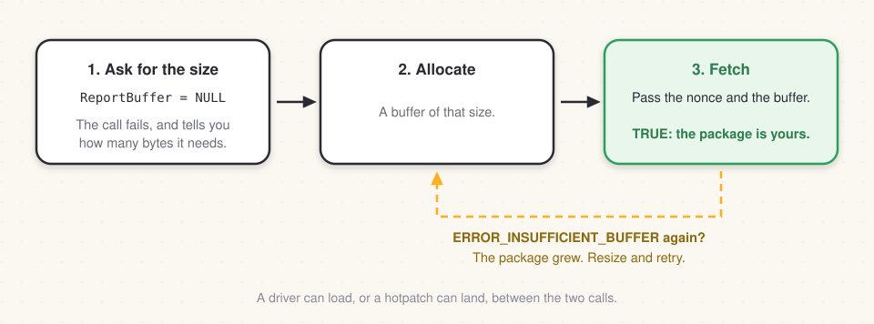

Parts [1](/runtime-attestation-report-wip/) and [2](/runtime-attestation-trust-model-wip/) of this series covered why the Windows Runtime Attestation Report exists and why a server can believe one. This post is the practical one.

You call a single Win32 API and get back a buffer of bytes. I'll go through what each section of that buffer is for, and how the sample walks it without trusting a size or an offset it hasn't checked.

Here's what the [sample](https://github.com/CodeMaxx/windows-runtime-attestation-report){: target="_blank" rel="noopener" } prints for a package that holds two reports. It's the same run I showed in Part 1:

```plaintext
========================================================================
  Runtime Report Package
========================================================================
  version   : 1
  reports   : 2
  size      : 10520 bytes
  digest    : SHA-512
  signature : RSA-PSS SHA-512

========================================================================
  Report 1 of 2  -  Driver report
========================================================================
  97 driver(s)

  [0] crashdmp.sys (loads=1)
      image hash      (SHA-256): bc78167bb32c243d41c061bbb76dc6cb5fe69dd637cf6632e166e8c316e1e88d
      cert thumbprint (SHA-1): 1b5c9e0cfdfd9cd0744637d8b2d3b62b5081c467

  [1] diskdump.sys (loads=1 unloaded)
  ...
```

All of that came back in one buffer. The layout of the package fits in one picture:

{: .shadow }
_Top to bottom is the order of the bytes in the buffer._

> A note on where this comes from: I work on the Windows Secure Kernel team at Microsoft, and I built the Runtime Attestation Report. The code in this post is from the public sample, which uses only the public Windows SDK.
{: .prompt-info }

## What you'll need

All the code in this walkthrough is in the companion [sample repository on GitHub](https://github.com/CodeMaxx/windows-runtime-attestation-report){: target="_blank" rel="noopener" }.

### Build requirements

- **Windows SDK 10.0.29648**, available through the [`Microsoft.Windows.SDK.CPP` 10.0.29648.1000-preview](https://www.nuget.org/packages/Microsoft.Windows.SDK.CPP/10.0.29648.1000-preview){: target="_blank" rel="noopener" } NuGet package.

- Ensure `NTDDI_VERSION >= NTDDI_WIN11_GE` is set in your build configuration.

- Link against **`onecore.lib`** for the API export.

### Runtime requirements

- **Windows 11 25H2 or later**, with **VBS enabled**.

- The **driver report** also requires **HVCI**.

- The **hotpatch report** requires **Windows 11 Insider Experimental (Future Platforms) Preview Build 29591.1000 or later**. It does not require HVCI.

## Calling the API

### The function

```cpp
BOOL GetRuntimeAttestationReport(
    UCHAR*  Nonce,              // 32 bytes; NULL for a size query
    UINT16  PackageVersion,     // the package format version
    UINT64  ReportTypesBitmap,  // which reports you want
    PVOID   ReportBuffer,       // output; NULL for a size query
    PUINT32 ReportBufferSize    // in: size; out: written or needed
);
```
{: file="sysinfoapi.h" }

The function is declared in `sysinfoapi.h`. The package structures and the `RUNTIME_REPORT_TYPE` enumeration are in `winnt.h`, so including `windows.h` brings in everything.

For `PackageVersion`, pass `RUNTIME_REPORT_PACKAGE_VERSION_CURRENT`. The function returns `TRUE` on success. On failure it returns `FALSE`, and `GetLastError()` tells you why.

### Choosing the reports

Each report type is one bit in `ReportTypesBitmap`. The `RUNTIME_REPORT_TYPE_TO_MASK` macro turns an enumeration value into its bit, and you OR together the ones you want:

```cpp
UINT64 reportTypes =
    RUNTIME_REPORT_TYPE_TO_MASK(RuntimeReportTypeDriver) |
    RUNTIME_REPORT_TYPE_TO_MASK(RuntimeReportTypeHotpatch);
```

One package comes back, with both reports under one signature.

If you ask for a type that the running build doesn't support, the call fails with `ERROR_INVALID_PARAMETER`. The same error comes back for a genuinely bad argument, so the error code alone can't tell you which of the two happened.

### Size first, then fetch

You don't know how big the package is up front, so the usual pattern is two calls. The first passes a `NULL` buffer. It fails with `ERROR_INSUFFICIENT_BUFFER`, but it fills in the required size. The second call passes a buffer that big.

There's a catch, though. The package can grow between those two calls: a driver could load, or a hotpatch could land. When that happens, the second call fails with `ERROR_INSUFFICIENT_BUFFER` again, and you resize the buffer and retry.

{: .shadow }
_The sample gives up after four attempts rather than looping forever._

Here is the loop I use in the sample, reformatted to fit the page and with the error messages removed:

```cpp
UINT32 size = 0;
if (!GetRuntimeAttestationReport(
        nullptr, RUNTIME_REPORT_PACKAGE_VERSION_CURRENT,
        reportTypes, nullptr, &size) &&
    GetLastError() != ERROR_INSUFFICIENT_BUFFER) {
    return false;   // a real failure, not just a small buffer
}

constexpr int kMaxFetchAttempts = 4;

for (int attempt = 0; attempt < kMaxFetchAttempts; attempt += 1) {
    package.resize(size);
    if (GetRuntimeAttestationReport(
            nonce, RUNTIME_REPORT_PACKAGE_VERSION_CURRENT,
            reportTypes, package.data(), &size)) {
        package.resize(size);   // bytes actually written
        return true;
    }

    if (GetLastError() != ERROR_INSUFFICIENT_BUFFER) {
        return false;
    }
}

return false;       // the size kept growing
```
{: file="src/main.cpp" }

You can also skip the size query and pass a buffer you're confident is big enough. That saves a call, but the size is still dynamic. If you hardcode one, it works until the day a machine has more drivers than you planned for, so check for `ERROR_INSUFFICIENT_BUFFER` and grow the buffer either way.

### The nonce

The first argument is the 32-byte nonce, and [Part 2](/runtime-attestation-trust-model-wip/#why-your-server-picks-the-nonce) explains why it has to come from your server. The sample has no server, so it fills the nonce with `BCryptGenRandom` just to have something to pass.

## The package layout

### Two parts and a signature

The package has three sections, packed one after another with no padding:

- The **signed part** comes first. It holds the package header, the nonce, and one digest header for each report.

- The **signature blob** follows. It's an RSA-PSS signature, with SHA-512, over the signed part.

- The **authenticated part** comes last. It holds the reports themselves, and each one starts with a small report header.

The reports aren't signed directly. Each report is hashed with SHA-512, header included, and that hash is stored in a digest header inside the signed part. Consequently, a report can be trusted only after its hash has been checked against its digest header.

### The package header

```cpp
typedef struct _RUNTIME_REPORT_PACKAGE_HEADER {
    UINT32 Magic;                          // "RTRP"
    UINT16 PackageVersion;                 // Currently 1
    UINT16 NumberOfReports;                // Number of report types
    UINT64 ReportTypesBitmap;              // Which report types
    UINT32 PackageSize;                    // Whole package size
    UINT16 ReportDigestType;               // CALG_SHA_512
    UINT16 TotalReportDigestsSize;         // All the digest headers
    UINT16 Reserved;                       // Must be zero
    UINT16 SignatureScheme;                // RSA-PSS with SHA-512
    UINT32 SignatureSize;                  // The signature blob
    UINT32 TotalAuthenticatedReportsSize;  // All the reports
} RUNTIME_REPORT_PACKAGE_HEADER;
```
{: file="winnt.h" }

Two of these fields matter more than they look:

- `ReportTypesBitmap` lists the report types that are actually in the package. It sits in the signed part, so a server can rely on it to notice when a report its policy needs was never requested.

- `PackageSize` is the size of the whole package. The sample compares it with the number of bytes the API returned, and rejects the package if they differ.

The three size fields, `TotalReportDigestsSize`, `SignatureSize` and `TotalAuthenticatedReportsSize`, give the size of each section, and each section starts where the one before it ends.

### Digest headers and report headers

```cpp
typedef struct _RUNTIME_REPORT_DIGEST_HEADER {
    UINT16 ReportType;      // Which report was hashed
    UINT16 Reserved;
    UINT8  ReportDigest[RUNTIME_REPORT_DIGEST_MAX_SIZE];  // SHA-512
} RUNTIME_REPORT_DIGEST_HEADER;

typedef struct _RUNTIME_REPORT_HEADER {
    UINT16 ReportType;      // Driver, Hotpatch, ...
    UINT16 Reserved;
    UINT32 ReportSize;      // Bytes in this report, header included
} RUNTIME_REPORT_HEADER;
```
{: file="winnt.h" }

There is one digest header and one report header per report, and both carry the `ReportType`.

`ReportSize` includes the report header. Adding it to a report's offset gives the offset of the next report.

## Parsing the package

### Finding the sections

The sections follow the header in a fixed order, so four additions give every offset. `total` is the number of bytes the API returned, and `InRange` is a helper I'll get to in a moment:

```cpp
size_t nonceOffset     = sizeof(RUNTIME_REPORT_PACKAGE_HEADER);
size_t digestsOffset   = nonceOffset + RUNTIME_REPORT_NONCE_SIZE;
size_t signatureOffset = digestsOffset + header->TotalReportDigestsSize;
size_t reportsOffset   = signatureOffset + header->SignatureSize;

if (!InRange(reportsOffset, header->TotalAuthenticatedReportsSize, total)) {
    return false;   // the sections run past the buffer
}
size_t reportsEnd = reportsOffset + header->TotalAuthenticatedReportsSize;
```
{: file="src/main.cpp" }

Because nothing is padded, a structure can start at an unaligned offset. The sample reads every structure through an `UNALIGNED` pointer, which keeps field access correct on both x64 and ARM64.

### Check before you read

The buffer travelled through VTL0. Until the signature and the digests have been verified, every size and offset in it could have been chosen by an attacker, and a parser that trusts them will read out of bounds.

The sample guards every read with one small helper:

```cpp
// True if [offset, offset + length) fits within 'total' bytes.
inline bool InRange(size_t offset, size_t length, size_t total)
{
    return offset <= total && length <= total - offset;
}
```
{: file="src/Helpers.h" }

Written this way, the check can't overflow, whatever values the package claims.

Then it walks the reports. `Overlay` is another small helper in the sample, which turns an offset in the buffer into an `UNALIGNED` structure pointer. I've left out the banner printing:

```cpp
size_t cursor = reportsOffset;
for (UINT16 i = 0; i < header->NumberOfReports; i += 1) {
    if (!InRange(cursor, sizeof(RUNTIME_REPORT_HEADER), reportsEnd)) {
        return false;   // truncated report header
    }

    const RUNTIME_REPORT_HEADER UNALIGNED* reportHeader =
        Overlay<RUNTIME_REPORT_HEADER>(data, cursor);
    UINT32 reportSize = reportHeader->ReportSize;

    if (reportSize < sizeof(RUNTIME_REPORT_HEADER) ||
        !InRange(cursor, reportSize, reportsEnd)) {
        return false;   // impossible report size
    }

    switch (reportHeader->ReportType) {
    case RuntimeReportTypeDriver:
        if (!PrintDriverReport(data + cursor, reportSize)) {
            return false;
        }
        break;

    case RuntimeReportTypeHotpatch:
        if (!PrintHotpatchReport(data + cursor, reportSize)) {
            return false;
        }
        break;

    default:
        break;      // no decoder; step over it using ReportSize
    }

    cursor += reportSize;
}

if (cursor != reportsEnd) {
    return false;       // leftover bytes no report accounts for
}
```
{: file="src/main.cpp" }

That last check is the one I'd expect people to leave out. If the reports don't add up to exactly `TotalAuthenticatedReportsSize`, the package is inconsistent, and the sample rejects it.

### What a real verifier adds

The sample parses and prints. It doesn't verify the signature or the digests, so treat it as the client half only. On your server, the order of the checks matters:

1. Check the magic, the package version and the signature scheme.

2. Verify the signature over the signed part, using a public key the server already trusts.

3. Check that the nonce is the one you sent.

4. Check that `ReportTypesBitmap` includes every report your policy needs.

5. Hash each report and compare the result with its digest header.

6. Only then read what the reports say.

Part 6 of this series covers each of these steps.

## Try the sample

The sample pulls all of this together. It fetches the package, walks it, and prints the reports:

```
> WindowsRuntimeAttestationReport.exe --type all
```

`--type` takes `driver`, `hotpatch` or `all`, and it defaults to `driver`. Full source code and build instructions are available on GitHub: [github.com/CodeMaxx/windows-runtime-attestation-report](https://github.com/CodeMaxx/windows-runtime-attestation-report){: target="_blank" rel="noopener" }.

The next two posts go through the reports themselves. [Part 4](/secure-hotpatch-report/) covers the hotpatch report and is already published, and Part 5 covers the driver report.

Thank you for reading! If something here is unclear, or you spot a mistake, let me know in the comments. I'd love to hear from you. :)

> Prefer reading the header? Search `winnt.h` for "Runtime Report Definitions". The package layout is drawn there in a comment, above the structures.
{: .prompt-tip }
