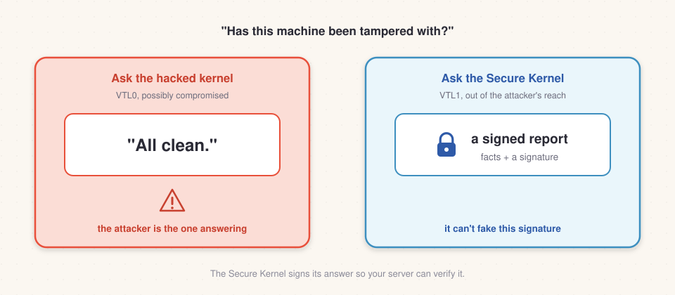

Kernel anti-cheat exists to answer one question: has this machine been tampered with? Its driver runs in the Windows kernel, at the same level as the cheats it is looking for, and it asks the kernel what is loaded and what has changed.

Now picture a cheat that got into the kernel first. Every one of those questions is answered by the part of Windows the attacker already controls, so the answer comes back clean every time.

A hacked computer will happily lie to you about being hacked.

Windows now has a way out of this, and it's genuinely one of my favourite things we've shipped. It's called the Windows Runtime Attestation Report. A single Win32 API, [`GetRuntimeAttestationReport`](https://learn.microsoft.com/windows/win32/api/sysinfoapi/nf-sysinfoapi-getruntimeattestationreport){: target="_blank" rel="noopener" }, returns a package of facts about the machine, signed by a part of Windows that the normal kernel cannot reach. Even a fully compromised normal kernel can't forge that signature.

{: .shadow }
_The report still travels out through VTL0. Verification happens later, on your server._

> A note on where this comes from: I work on the Windows Secure Kernel team at Microsoft, and I built the Runtime Attestation Report.
{: .prompt-info }

Games are the easiest place to picture the problem, but it shows up anywhere a service has to make a trust decision about a machine it can't inspect. I'll come back to those cases at the end.

## Who are you proving this to?

Look at what failed in that scenario. The thing being inspected was also the thing answering the questions, and asking harder or more cleverly doesn't change that.

The decision therefore has to be made somewhere the attacker cannot reach, which in practice is a remote server. The machine collects facts about itself and sends them to that server, which decides whether to trust it.

That only works if the machine cannot alter those facts on the way out. A signed report doesn't un-hack a compromised machine. It removes the attacker's ability to rewrite the evidence once the Secure Kernel has produced it.

This is remote attestation: a machine proving facts about itself to a party that has no reason to believe it.

Remote attestation is usually associated with the TPM and measured boot, where the machine records what it loaded during startup so that a server can check the boot chain afterwards. That answers a different question. Measured boot describes how the machine started; it does not describe a driver that loaded twenty minutes ago or a patch applied since. The Runtime Attestation Report covers the state of the machine at the moment of the request, which is where the "runtime" in the name comes from.

## An answer the kernel can't forge

The answer cannot come from the normal kernel, since that is the part that might be compromised. It has to come from somewhere the attacker cannot follow.

On a lot of Windows 11 machines, [Virtualization Based Security](https://learn.microsoft.com/windows-hardware/design/device-experiences/oem-vbs){: target="_blank" rel="noopener" } is already enabled. With VBS, Windows runs two kernels instead of one. The normal kernel---the one that drivers, anti-cheat and kernel cheats all run in---is isolated by the hypervisor. On the other side of that boundary is a second kernel, much smaller and more trusted: the Secure Kernel.

The normal world is called VTL0 and the secure world, where the Secure Kernel runs, is VTL1. Even an attacker with full control of VTL0 cannot read VTL1 memory or run code there, because the hypervisor and the CPU's virtualization hardware enforce the boundary. That is the assumption behind everything in this post: the attacker may control the normal kernel, but the hypervisor and the Secure Kernel are intact.

VTL0 is not cut off entirely, or there would be no API to call. It can make requests through a fixed set of calls that VTL1 chooses to answer.

The Secure Kernel holds a private signing key that VTL0 never sees. It signs every package with that key, and your server checks the signature against the matching public key.

There's a detail here that's easy to get wrong. Your server has to trust that public key *before* the package arrives. If it accepts whatever key is sent along with the package, a compromised machine can generate its own key pair, sign anything it likes and send the matching public key, and the check will pass while proving nothing. That trust is rooted in the TPM. During boot, Windows measures a number of things into the TPM, and the Secure Kernel's public signing key is one of them. Your server replays that log of measurements, checks the result against values the TPM itself has signed, and only then accepts that the key came from a machine that booted the way it claims. So the TPM does have a role here: it anchors the key, while the report describes what is running now. My colleague Andrea Allievi has written about [how the TPM side of this works](https://www.andrea-allievi.com/blog/new-year-post-anti-cheat-evolution-in-windows-11/){: target="_blank" rel="noopener" }, and I'll cover the verification steps later in this series.

{: .shadow }
_VTL0 asks and VTL1 answers, which is also how your server's challenge gets across._

Everything in VTL0, including the application that requests the report, acts as an untrusted courier carrying a sealed envelope. It can read the contents or fail to deliver them, but any change to the contents breaks the seal.

One more point matters for anyone writing policy. A verified package proves that the Secure Kernel produced it. It does not say where the Secure Kernel got each fact. A notary's stamp works the same way: it proves the document was signed in front of the notary and says nothing about whether the contents are true. Some fields in a report are measured by VTL1 itself, while others are supplied by VTL0 and recorded as given. Both are covered by the same signature, so a policy needs to know which is which. The [hotpatch post](/secure-hotpatch-report/) shows exactly where that line falls for one report type.

## What the package contains

The package works like an envelope with several documents inside, and each document is a report of a particular type:

- The **driver report** lists the kernel drivers the machine has loaded, including ones that have since been unloaded, with enough identity on each to tell the real `nvlddmkm.sys` from an impostor with the same name.

- The **hotpatch report** lists the kernel-mode images that currently have a Microsoft hotpatch applied.

- The Windows SDK also defines a **Code Integrity** report type.

This series and the public sample focus on the driver and hotpatch reports. The framework is designed so that new report types can be added without changing the API, and the hotpatch report is one I added that way.

Here is the top of a package from the sample, run on a test machine:

```plaintext
========================================================================
  Runtime Report Package
========================================================================
  version   : 1
  reports   : 2
  size      : 10520 bytes
  digest    : SHA-512
  signature : RSA-PSS SHA-512
```

The package holds two reports in about ten kilobytes, with a single signature that authenticates both through their digests. A later post covers the format field by field. For now, the important detail is that the list of report types in the package is *inside* the signed part, which matters once the attacker has the kernel.

{: .shadow }
_The list of report types in the package sits inside the signed part, so your server can tell when one is missing._

## How the round trip works

The code is in the next post, but it helps to know the shape of the exchange first.

1. Your server picks a fresh random number and sends it to the machine as a challenge.
2. Your app calls `GetRuntimeAttestationReport`, saying which reports it wants and passing along that challenge.
3. The Secure Kernel builds each requested report and puts them in one package.
4. It signs the package, with your challenge inside it, and hands it back to your app.
5. Your app sends the signed package to your server.
6. Your server verifies it using a public key it already trusts, then checks that the challenge inside is the exact one it just sent.
7. If both hold, your server checks that every report its policy needs is in the package, then reads the facts and applies that policy.

{: .shadow }
_Steps 1, 6 and 7 are your server's responsibility. The app in the middle is only a courier and never has to be trusted._

The challenge in step 1 is a nonce, and it prevents replay. Without it, an attacker could capture one valid package from a healthy machine and resend it indefinitely, long after the machine was compromised. Because your server picks an unpredictable value each time and requires the same value inside the signed package, an old package no longer matches. A server that doesn't generate the nonce, or doesn't check it on return, gains nothing from it.

## Now give the attacker the kernel

Assume the attacker controls the entire normal kernel, while the hypervisor and the Secure Kernel are intact. These are the moves available.

**Tamper.** The attacker modifies the package, for example by removing a driver entry. Every report is bound to the signature through its digest, so any change makes verification fail and your server discards the package.

**Replay.** The attacker sends an old package, either one your server accepted earlier or one taken from another machine. That package contains a different challenge from the one in the current request, so your server rejects it.

**Ask for less.** The policy requires the driver report, so the compromised app requests only the hotpatch report and returns a package that is valid but incomplete. This is where the signed list of report types matters. The package states which report types it contains, the attacker cannot edit that list, and your server rejects any package that is missing a report its policy requires.

**Suppress.** The attacker blocks the call, drops the response, or runs with VBS disabled so that no report can be produced. An attacker can always stop a report from arriving. Whether a missing report counts as a failure is up to your server's policy.

None of these moves produces a valid VTL1 signature, because the signing key is out of the attacker's reach.

{: .shadow }
_Verification catches tampering and replay, and tells your server when a required report is missing. A missing package is a separate policy case._

There are three limitations to be aware of.

A report is a snapshot. It describes the machine up to the moment the Secure Kernel built it and says nothing about what happens afterwards, so a driver loaded a second later is not in it. The driver report helps here, because it also keeps entries for drivers that have since been unloaded, so the next report still shows that driver. This is why a service should request reports repeatedly, at times the machine cannot predict.

A report is also narrow. The driver report covers drivers and the hotpatch report covers hotpatched images. Neither says anything about a cheat running in user mode, for example. Consequently, a clean report is not the same thing as a clean machine.

The third limitation is a relay. A compromised machine can forward the challenge to a second, healthy machine, let that machine produce a genuine signed package, and return it to your server as its own. The nonce does not catch this, because both the signature and the challenge are genuine; they simply came from the wrong computer. This is the [cuckoo attack](https://www.usenix.org/event/hotsec08/tech/full_papers/parno/parno_html/){: target="_blank" rel="noopener" }, described by Bryan Parno in 2008, and it is not specific to Windows: every remote attestation scheme has to deal with it. Tracing the key back through the TPM tells your server which machine produced a report, but not that it is the machine your server meant to check. It's a known gap, and the report doesn't solve it today.

## What this is good for

None of this is specific to games. Anti-cheat is where it shows up first, but the same problem exists elsewhere:

- **Anti-cheat** needs to know what the machine has loaded, and whether a code change is a real patch or a hook. Riot's Vanguard uses the driver report for its [on-demand mode](https://www.riotgames.com/en/news/vanguard-on-demand){: target="_blank" rel="noopener" }.

- **Anti-malware and EDR** ask a similar question: is there an unexpected driver, and when kernel code has changed, does a legitimate patch explain it?

- **Enterprise access** needs to know whether a laptop is in the state that policy requires before it reaches company data.

The report does not answer any of these questions on its own. It provides evidence that VTL0 cannot edit after the fact, which is a much better starting point than anti-cheat has had.

## Try the sample

The public sample retrieves, parses and prints the driver and hotpatch reports on x64 and ARM64. It has no third-party dependencies beyond the Windows SDK and the MSVC toolchain, and it links the C runtime statically, so the executable runs without the Visual C++ Redistributable.

The sample only parses and prints. It does not verify the package signature or the report digests, so treat it as a starting point for the client side rather than a finished verifier.

The driver report requires Windows 11 25H2 or later with VBS and HVCI enabled. The hotpatch report requires Insider build 29591.1000 or later with VBS enabled, and does not require HVCI. The README has the details: [github.com/CodeMaxx/windows-runtime-attestation-report](https://github.com/CodeMaxx/windows-runtime-attestation-report){: target="_blank" rel="noopener" }.

The rest of the series:

1. **This post.** Why a compromised kernel can't vouch for itself, and what a signed report does and doesn't prove.
2. **The package and the API.** What comes back from the call field by field, and how to pull the reports out in code.
3. **[The Secure Hotpatch Report](/secure-hotpatch-report/).** Telling a real Microsoft hotpatch apart from kernel tampering.
4. **The driver report.** Every driver the machine has loaded, including the ones that are gone again, with the identity you need to spot an impostor.
5. **Trusting the key.** How your server uses the TPM to decide the signing key belongs to a real Secure Kernel.

Thank you for reading! If something here is unclear, or you spot a mistake, let me know in the comments. I'd love to hear from you. :)

> Just want the API reference? The Learn page for [`GetRuntimeAttestationReport`](https://learn.microsoft.com/windows/win32/api/sysinfoapi/nf-sysinfoapi-getruntimeattestationreport){: target="_blank" rel="noopener" } has the function parameters and the package layout.
{: .prompt-tip }
