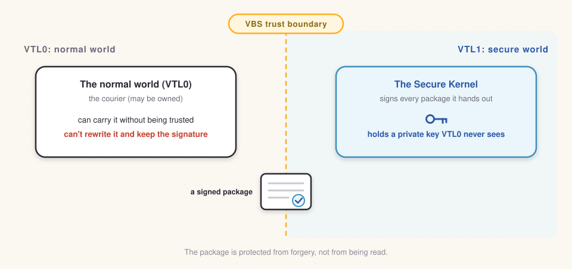
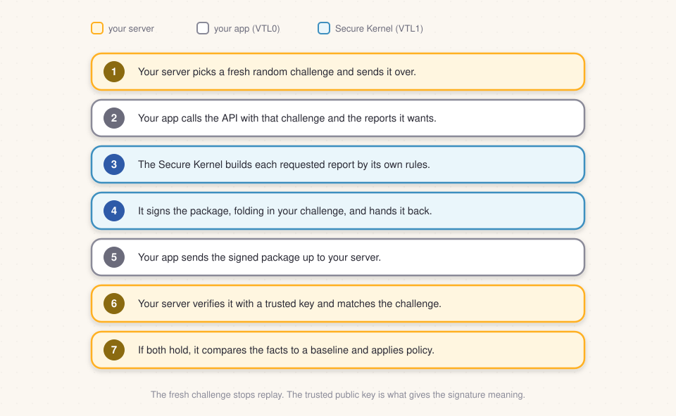
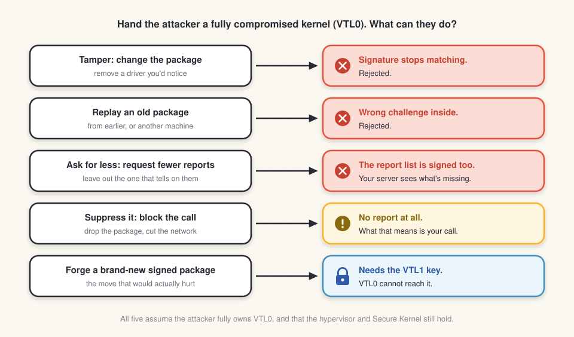

Say you're writing anti-cheat. Your driver sits in the Windows kernel, down where the serious cheats operate, and your job is to spot tampering. So you ask the kernel what's loaded and what has changed.

Now suppose the cheat got into the kernel before you did. You're querying the part of Windows the attacker already owns. The answer comes back clean, every time, because whatever writes that answer is the exact thing you were hunting for.

A hacked computer will happily lie to you about being hacked.

Windows has a way out of this now, and it's genuinely one of my favourite things we've shipped. It's called the Windows Runtime Attestation Report. One Win32 API, [`GetRuntimeAttestationReport`](https://learn.microsoft.com/windows/win32/api/sysinfoapi/nf-sysinfoapi-getruntimeattestationreport){: target="_blank" rel="noopener" }, hands you back a package of facts about the machine, signed by a part of Windows that the normal kernel cannot reach into. Even a fully compromised kernel can't forge that signature.

{: .shadow }
_The report still travels out through VTL0. Verification happens later, on your server._

> For context: I'm an engineer on the Windows Secure Kernel team at Microsoft, and the Runtime Attestation Report is a feature I built. So this is the view from the inside, not a reverse-engineering guess.
{: .prompt-info }

Games are just the easiest place to picture the problem. The same shape turns up anywhere a service has to make a trust decision about a machine it can't physically inspect, and I'll come back to those at the end.

## Who are you even proving this to?

Look again at what actually failed up there. The thing being inspected was also the thing answering, and asking harder or more cleverly doesn't change that.

So the decision has to move somewhere the attacker can't reach, which in practice means a server you control. The machine gathers facts about itself, ships them off, and your server decides what to do about them.

That only works if the machine can't quietly doctor the answer on its way out. A signed report doesn't un-hack a compromised machine. What it takes away is the attacker's ability to rewrite the evidence once the Secure Kernel has produced it.

This is remote attestation, which is just a machine proving facts about itself to somebody who has every reason not to believe it.

You may already know remote attestation through the TPM, best known around here for recording what a machine loaded on the way up so that a server can check the boot chain afterwards. That answers a different question. Measured boot tells you how the machine started; it has nothing to say about a driver that loaded twenty minutes ago, or a patch that landed since. This report covers what is there at the moment you ask, which is where the "runtime" in the name comes from.

## An answer the kernel can't forge

The answer can't come from the normal kernel, since that's the part that might be compromised. It has to come from somewhere the attacker can't follow.

On a lot of Windows 11 machines, [Virtualization Based Security](https://learn.microsoft.com/windows-hardware/design/device-experiences/oem-vbs){: target="_blank" rel="noopener" } is already switched on. With VBS enabled, Windows runs two kernels instead of one. There's the normal kernel you already know---the one your driver and the cheat's driver both live in---and the hypervisor enforces a wall around it. Behind that wall sits a second kernel, much smaller and much more trusted: the Secure Kernel.

The normal world is called VTL0, and the secure world where the Secure Kernel runs is VTL1. The boundary between them is the whole point. A rootkit can own VTL0 completely and still not get into VTL1: it can't read that memory and it can't run code there, because the hypervisor won't allow it and the CPU's virtualization hardware is what makes that stick. That is the assumption behind everything in this post: the attacker can have the normal kernel, but the hypervisor and the Secure Kernel are intact.

VTL0 isn't cut off entirely, or there'd be no API to call. It can ask through a fixed set of calls that VTL1 chooses to answer.

The Secure Kernel holds a private signing key that VTL0 never sees. When it builds a package it signs it with that key, and your server checks the signature against the matching public key.

Your server has to trust that public key *before* the package turns up, and this is where the whole scheme quietly falls apart if you get it wrong. If it just accepts whatever key arrives alongside the package, then a compromised machine generates its own key pair, signs whatever it likes, sends you the matching public key, and your check passes while proving absolutely nothing. That trust is rooted in the TPM. During boot, Windows measures things into it, and the Secure Kernel's public signing key is one of them. Your server replays that log of measurements, checks the result against a set of values the TPM itself has signed, and only then believes the key came from a machine that booted the way it claims to have booted. The TPM does have a job here after all: it anchors the key rather than telling you what's running right now. My colleague Andrea Allievi has written up [how the TPM side of this works](https://www.andrea-allievi.com/blog/new-year-post-anti-cheat-evolution-in-windows-11/){: target="_blank" rel="noopener" } in detail, and I'll walk through the checking end of it later in the series.

{: .shadow }
_VTL0 asks and VTL1 answers, which is also how your server's challenge gets across._

Think of everything in VTL0, your own app included, as an untrusted courier carrying a sealed envelope. It can read what's inside or lose it on the way, but altering the contents breaks the seal before your server ever opens it.

A verified package tells you the Secure Kernel produced it. It doesn't tell you where the Secure Kernel got each individual fact. A notary's stamp works the same way: it proves the document was signed in front of the notary, and says nothing about whether the contents are true. Some of what lands in a report was measured by VTL1 itself. Some of it was handed over by VTL0 and written down. Both end up under the same signature, so your policy needs to know which is which. The [hotpatch post](/secure-hotpatch-report/) walks through exactly where that line falls for one report type, and it isn't where most people assume.

## What you actually get back

The package works like an envelope with a few separate documents inside it.

Each document is a report of a particular kind. The driver report lists kernel drivers the machine has loaded, including ones that have since been unloaded, with enough identity on each to tell the real `nvlddmkm.sys` from an impostor with the same name. The hotpatch report says which kernel-mode images currently have a live Microsoft patch on them. The Windows SDK defines a Code Integrity report type as well. This series and the public sample concentrate on the driver and hotpatch reports, and more kinds can be added later without changing how you ask.

Running the sample on a test machine, the top of that package looks like this:

```plaintext
========================================================================
  Runtime Report Package
========================================================================
  version   : 1
  reports   : 2
  size      : 10520 bytes
  digest    : SHA-512
  signature : RSA-PSS SHA-512
```

Two reports, ten kilobytes, one signature that authenticates both through their digests. The field-by-field breakdown comes later; for now the only thing worth noticing is that the list of report types in the package is recorded *inside* the signed part, which matters once we give the attacker the kernel.

{: .shadow }
_The list of report types in the package sits inside the signed part, so your server can tell when one is missing._

## How the round trip works

The code comes in the next post, but the shape of the exchange is worth having in your head first.

1. Your server picks a fresh random number and sends it to the machine as a challenge.
2. Your app calls `GetRuntimeAttestationReport`, saying which reports it wants and passing along that challenge.
3. The Secure Kernel builds each requested report and puts them in one package.
4. It signs the package, with your challenge inside it, and hands it back to your app.
5. Your app ships the signed package to your server.
6. Your server verifies it using a public key it already trusts, then checks that the challenge inside is the exact one it just sent.
7. If both hold, your server checks that every report its policy needs is in the package, then reads the facts and applies that policy.

{: .shadow }
_Steps 1, 6 and 7 are yours to get right. Your app in the middle is only a courier, and never has to be trusted._

That challenge in step 1 is called a nonce, and it stops an old report being replayed. Without it an attacker captures one good package from a healthy machine and keeps re-sending it forever, long after the machine has gone bad. Because your server picks an unpredictable value every time and insists on seeing that same value back inside the signed package, yesterday's copy no longer matches. If your server doesn't generate it, or forgets to check it on the way back, you've gained nothing.

## Now give the attacker the kernel

Assume the worst. The attacker owns the entire normal kernel, and the hypervisor and Secure Kernel are still standing. What moves are left?

The obvious move is to **tamper** with the package, flipping a bit or lifting out the driver they'd rather you didn't see. But every report is bound to the signature, so the moment anything changes, verification fails and your server throws the package away.

They might instead **replay** an old package, either one your server accepted earlier or one lifted from a different machine. But you put a fresh challenge in this request, and that old package has a different one sealed inside it. No match, and it's rejected.

A subtler option is to **ask for less**. Your policy needs the driver report, so the compromised app requests only the hotpatch report and returns something perfectly valid and conveniently incomplete. This is where that signed list pays off. The package says which report types it contains, the attacker can't edit that list, and your server rejects any package that is missing a report your policy needs.

The crude fallback is **suppression**. Kill the call, drop the response, or show up with VBS switched off so there's no report to send in the first place. They can stop you getting an answer, but they can't turn that silence into a pass unless you let them. What happens next is your policy's call.

None of these moves lets them forge a valid VTL1 signature. That key is somewhere they can't reach.

{: .shadow }
_Verification catches tampering and replay, and tells your server when a required report is missing. A missing package is a separate policy case._

There are three limitations you should know about.

A report is a snapshot. It describes the machine up to the moment the Secure Kernel built it and says nothing about what happens afterwards, so a driver loaded a second later isn't in it. The driver report softens this, because it also keeps entries for drivers that have since been unloaded, so the next report still shows that driver. That's the reason to ask again, often, at times the machine can't predict.

A report is also narrow. The driver report covers drivers and the hotpatch report covers hotpatched images. Neither says anything about a cheat running in user mode, for example, so a clean report is not the same thing as a clean machine.

The third is nastier, and it has a name. A hacked machine can forward your challenge to a second, healthy machine, let that one produce a genuine signed package, and pass it back to your server as its own. The nonce doesn't catch this, because the signature is real and the challenge is real. They just came from the wrong computer. This is the [cuckoo attack](https://www.usenix.org/event/hotsec08/tech/full_papers/parno/parno_html/){: target="_blank" rel="noopener" }, which Bryan Parno wrote up in 2008, and nothing about it is specific to Windows. Every remote attestation scheme has to deal with it. Tracing the key back through the TPM tells your server which machine produced a report. It doesn't tell your server that this is the machine it meant to check. I'll come back to what you can do about that in the last post of this series.

## What this is good for

None of this is really about games. Anti-cheat is just the loudest place it shows up first, and once you take the games out, the same shape is everywhere.

- **Anti-cheat** asks what the machine has loaded, and whether a code change is a real patch or a hook. Riot's Vanguard uses the driver report for its [on-demand mode](https://www.riotgames.com/en/news/vanguard-on-demand){: target="_blank" rel="noopener" }.
- **Anti-malware and EDR** ask a similar question: is there a driver down there nobody expected, and when kernel code has changed, is there a legitimate patch that explains it?
- **Enterprise access** asks whether a laptop is in the state policy requires before it gets near company data.

The report doesn't answer any of these on its own, but it gives you an answer VTL0 can't edit after the fact, which is a much better starting point than anti-cheat has had.

## Try it yourself

The public sample retrieves, parses and prints the driver and hotpatch reports on x64 and ARM64. It needs no third-party dependencies, just the Windows SDK and the MSVC toolchain, and it statically links the C runtime so the executable runs without the Visual C++ Redistributable.

It only parses and prints, so it doesn't verify the package signature or the report digests. Treat it as a starting point for the client side rather than a finished verifier.

For a driver report you'll want Windows 11 25H2 or later with VBS and HVCI enabled. The hotpatch report needs Insider build 29591.1000 or later with VBS on, and doesn't require HVCI. The README spells all of that out: [github.com/CodeMaxx/windows-runtime-attestation-report](https://github.com/CodeMaxx/windows-runtime-attestation-report){: target="_blank" rel="noopener" }.

The rest of the series:

1. **This post.** Why a compromised kernel can't vouch for itself, and what a signed report does and doesn't prove.
2. **The package and the API.** What comes back from the call field by field, and how to pull the reports out in code.
3. **[The Secure Hotpatch Report](/secure-hotpatch-report/).** Telling a real Microsoft hotpatch apart from kernel tampering.
4. **The driver report.** Every driver the machine has loaded, including the ones that are gone again, with the identity you need to spot an impostor.
5. **Trusting the key.** How your server uses the TPM to decide the signing key belongs to a real Secure Kernel, and what that does and doesn't tell you about which machine you're talking to.

Thank you for reading! If any of this is unclear, or you think I've got something wrong, let me know in the comments. :)

> Just want the API reference? The Learn page for [`GetRuntimeAttestationReport`](https://learn.microsoft.com/windows/win32/api/sysinfoapi/nf-sysinfoapi-getruntimeattestationreport){: target="_blank" rel="noopener" } has the function parameters and the package layout.
{: .prompt-tip }
