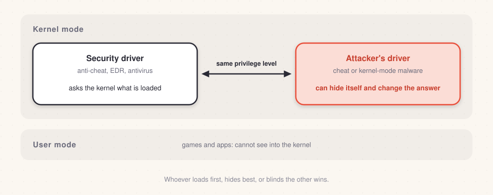
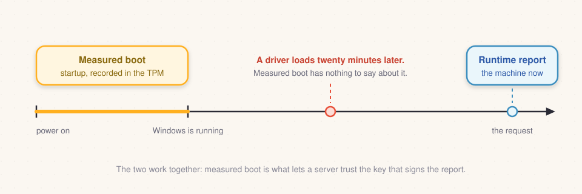
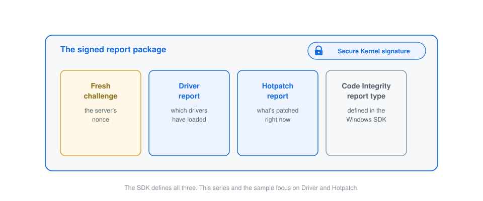

The nastiest game cheats don't live in the game, and the nastiest malware doesn't live in your apps. Both run in kernel mode, where user-mode software simply can't see them.

So anti-cheat, EDR and antivirus went into the kernel too. Now it's two drivers at the same privilege level, and whoever loads first, hides best, or blinds the other wins.

That leaves security software asking the kernel what is loaded and what has changed, and getting its answer from a kernel the attacker may already control.

A hacked computer will happily lie to you about being hacked.

{: .shadow }
_Security software followed the attackers into the kernel, and neither one is above the other._

Windows now has a way out of this, and it's genuinely one of my favourite things we've shipped. It's called the Windows Runtime Attestation Report. This post covers the problem it solves, why the attestation that already existed doesn't solve it, and what the report gives you instead. The rest of the series goes into how it works.

> A note on where this comes from: I work on the Windows Secure Kernel team at Microsoft, and I built the Runtime Attestation Report.
{: .prompt-info }

Anti-cheat is the example I'll use most in this post, because it is the easiest to picture. The same problem exists for any service that has to make a trust decision about a machine it can't inspect, and I'll come back to those cases at the end.

## Why the machine can't vouch for itself

Look at what failed in that scenario. The thing being inspected was also the thing answering the questions, and asking harder or more cleverly doesn't change that.

The decision therefore has to be made somewhere the attacker cannot reach, which in practice is a remote server. The machine collects facts about itself and sends them to that server, which decides whether to trust it.

This is remote attestation: a machine proving facts about itself to a party that has no reason to believe it.

It only works if the facts come from a part of the machine the attacker doesn't control, and can't be altered on the way to the server. So there are two questions to ask of any attestation scheme: who produces the evidence, and what does the evidence cover?

## What exists today, and where it stops

Remote attestation isn't new. Three kinds are in wide use, and each one answers those two questions differently. Here they are next to the report:

{: .shadow }
_Who produces the evidence, what it covers, and where it stops._

### Measured boot

This is the one most people think of. As a Windows machine starts, the firmware [records in the TPM](https://learn.microsoft.com/windows/security/operating-system-security/system-security/secure-the-windows-10-boot-process){: target="_blank" rel="noopener" } a hash of the firmware, the boot loader, the boot drivers and everything else that loads before the anti-malware driver. A server can later ask for those measurements, signed by the TPM, and check that the machine started the way it should have.

Measured boot describes how the machine started. It does not describe a driver that loaded twenty minutes ago or a patch applied since.

On a timeline, the gap looks like this:

{: .shadow }
_A machine can start clean and be compromised an hour later._

### Runtime measurement on Linux

Linux goes further with the [Integrity Measurement Architecture](https://ima-doc.readthedocs.io/en/latest/ima-concepts.html){: target="_blank" rel="noopener" } (IMA). Depending on policy, IMA hashes files as they are opened, executed or loaded as kernel modules. It appends each hash to a log and extends a TPM register with it, so a server can check that the log hasn't been edited.

That covers the time after boot. But IMA is part of the Linux kernel, so the measuring is done by the kernel being measured. It also measures a file when the file is loaded, and changes made in memory afterwards are out of its scope.

### Enclave attestation

The third kind comes from trusted execution environments such as Intel SGX, AWS Nitro Enclaves and VBS enclaves on Windows. An enclave is a small isolated region that the rest of the system can't read or modify. It can produce a signed statement about itself: which code is running inside it, and that the platform underneath is genuine. On Windows the call is [`EnclaveGetAttestationReport`](https://learn.microsoft.com/windows/win32/api/winenclaveapi/nf-winenclaveapi-enclavegetattestationreport){: target="_blank" rel="noopener" }, which returns a report that "describes the current enclave".

That is the right evidence if you need to know that your code is running untouched inside the enclave. It says nothing about the state of the operating system around the enclave, which is what anti-cheat or EDR wants to know.

## The Windows Runtime Attestation Report

None of those three tells a server what a Windows kernel has loaded *right now*, in a form that kernel can't rewrite. The Runtime Attestation Report is built for that gap. A single Win32 API, [`GetRuntimeAttestationReport`](https://learn.microsoft.com/windows/win32/api/sysinfoapi/nf-sysinfoapi-getruntimeattestationreport){: target="_blank" rel="noopener" }, returns a package of facts about the machine as it is at the moment of the call, which is where the "runtime" in the name comes from.

The normal kernel doesn't produce or sign that package. On a machine with [Virtualization Based Security](https://learn.microsoft.com/windows-hardware/design/device-experiences/oem-vbs){: target="_blank" rel="noopener" } enabled, Windows runs a second, much smaller kernel called the Secure Kernel, and the hypervisor isolates it from the normal one. The Secure Kernel signs every package with a key the normal kernel never sees, so even a fully compromised normal kernel can't forge that signature.

Windows calls the normal world VTL0 and the secure world VTL1. You'll see those names in the figures and through the rest of the series, and Part 2 covers how the isolation works and why a server can rely on it.

Here are the two answers side by side:

{: .shadow }
_The report still travels out through VTL0. Verification happens later, on your server._

Measured boot still has a job here: it is how a server comes to trust the Secure Kernel's signing key, which Part 6 covers.

Each request also carries a fresh random value chosen by your server, and the Secure Kernel signs that value into the package. An old package doesn't contain the new value, so it can't be passed off as a current one.

### What's in a package

The package works like an envelope with several documents inside, and each document is a report of a particular type:

- The **driver report** lists the kernel drivers the machine has loaded, including ones that have since been unloaded, with enough identity on each to tell the real `nvlddmkm.sys` from an impostor with the same name.

- The **hotpatch report** lists the kernel-mode images that currently have a Microsoft hotpatch applied.

- The Windows SDK also defines a **Code Integrity** report type.

This series and the public sample focus on the driver and hotpatch reports. The framework is designed so that new report types can be added without changing the API, and the hotpatch report is one I added that way.

Here is the top of a package from the sample, run on a test machine:

```plaintext
========================================================================
  Runtime Report Package
========================================================================
  version   : 1
  reports   : 2
  size      : 10520 bytes
  digest    : SHA-512
  signature : RSA-PSS SHA-512
```

The package holds two reports in about ten kilobytes, with a single signature that authenticates both through their digests. Part 3 covers the format field by field.

{: .shadow }
_The list of report types in the package sits inside the signed part, so your server can tell when one is missing._

### What a report doesn't do

A signed report doesn't un-hack a compromised machine. It removes the attacker's ability to rewrite the evidence once the Secure Kernel has produced it.

A report is also a snapshot, and each report type covers one thing, so a clean report is not the same thing as a clean machine. Part 6 goes through what your server has to check, and what an attacker can still do.

## What this is good for

None of this is specific to games. Anti-cheat is where it shows up first, but the same problem exists elsewhere:

- **Anti-cheat** needs to know what the machine has loaded, and whether a code change is a real patch or a hook. Riot's Vanguard uses the driver report for its [on-demand mode](https://www.riotgames.com/en/news/vanguard-on-demand){: target="_blank" rel="noopener" }.

- **Anti-malware and EDR** ask a similar question: is there an unexpected driver, and when kernel code has changed, does a legitimate patch explain it?

- **Enterprise access** needs to know whether a laptop is in the state that policy requires before it reaches company data.

The report does not answer any of these questions on its own. It provides evidence that VTL0 cannot edit after the fact, which is a much better starting point than security software has had.

## Try the sample

The public sample retrieves, parses and prints the driver and hotpatch reports on x64 and ARM64. It has no third-party dependencies beyond the Windows SDK and the MSVC toolchain, and it links the C runtime statically, so the executable runs without the Visual C++ Redistributable.

Here is the start of the driver report, from the same run as the package above:

```plaintext
========================================================================
  Report 1 of 2  -  Driver report
========================================================================
  97 driver(s)

  [0] crashdmp.sys (loads=1)
      image hash      (SHA-256): bc78167bb32c243d41c061bbb76dc6cb5fe69dd637cf6632e166e8c316e1e88d
      cert thumbprint (SHA-1): 1b5c9e0cfdfd9cd0744637d8b2d3b62b5081c467

  [1] diskdump.sys (loads=1 unloaded)
      image hash      (SHA-256): 2e8af9ea474f3b8e2506f141c3cb1111092d38ec898b882a9cf43f58a375398e
      cert thumbprint (SHA-1): 1b5c9e0cfdfd9cd0744637d8b2d3b62b5081c467
```

The second entry is a driver that has already been unloaded, and the report still lists it.

The sample only parses and prints. It does not verify the package signature or the report digests, so treat it as a starting point for the client side rather than a finished verifier.

The driver report requires Windows 11 25H2 or later with VBS and HVCI enabled. The hotpatch report requires Insider build 29591.1000 or later with VBS enabled, and does not require HVCI. The README has the details: [github.com/CodeMaxx/windows-runtime-attestation-report](https://github.com/CodeMaxx/windows-runtime-attestation-report){: target="_blank" rel="noopener" }.

The rest of the series:

1. **This post.** The problem, why existing attestation doesn't solve it, and a first look at the report.
2. **[Why you can believe it](/runtime-attestation-trust-model-wip/).** Two kernels, the signing key, and the round trip between your server and the machine.
3. **[The package and the API](/runtime-attestation-api-package-wip/).** What comes back from the call field by field, and how to pull the reports out in code.
4. **[The Secure Hotpatch Report](/secure-hotpatch-report/).** Telling a real Microsoft hotpatch apart from kernel tampering.
5. **The driver report.** Every driver the machine has loaded, including the ones that are gone again, with the identity you need to spot an impostor.
6. **Checking a report.** How your server uses the TPM to trust the signing key, what it has to verify, and what an attacker can still do.

Thank you for reading! If something here is unclear, or you spot a mistake, let me know in the comments. I'd love to hear from you. :)

> Just want the API reference? The Learn page for [`GetRuntimeAttestationReport`](https://learn.microsoft.com/windows/win32/api/sysinfoapi/nf-sysinfoapi-getruntimeattestationreport){: target="_blank" rel="noopener" } has the function parameters and the package layout.
{: .prompt-tip }
