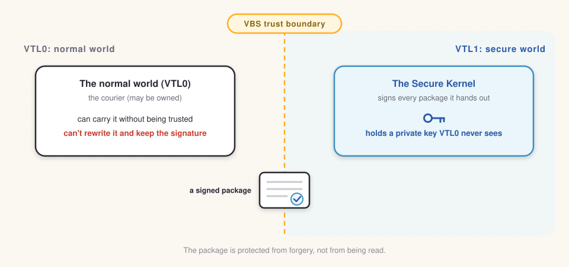
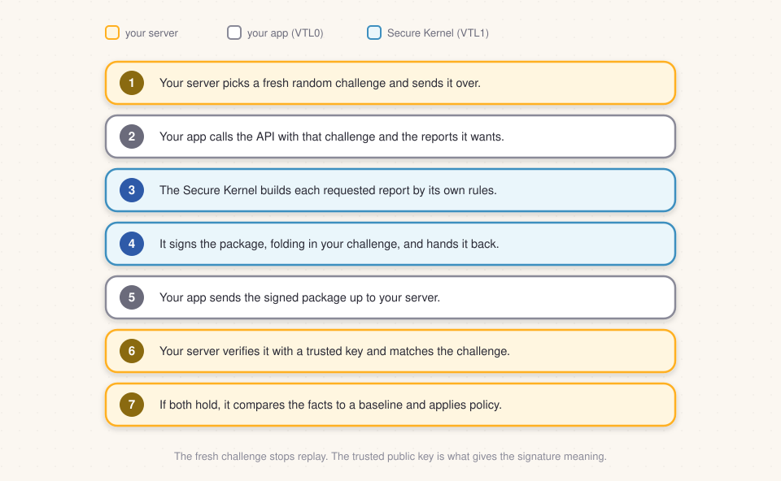

[Part 1](/runtime-attestation-report-wip/) of this series made a big claim: even a fully compromised Windows kernel can't forge a Runtime Attestation Report.

If you're going to ban a player or block a laptop on the strength of that report, one sentence isn't enough. You should know exactly what stands between an attacker and a fake one.

So take the worst case. A cheat or a rootkit has loaded its own driver and now runs with the same privileges as the Windows kernel. It can read and change the normal kernel's data, and it can feed false answers to every piece of software on the machine, your security driver included.

It still can't forge a report. This post explains why, and where that guarantee stops.

The whole idea fits in one picture:

{: .shadow }
_The security driver and the attacker's driver still share VTL0. The signing key lives where neither of them can reach._

> A note on where this comes from: I work on the Windows Secure Kernel team at Microsoft, and I built the Runtime Attestation Report.
{: .prompt-info }

## Two kernels instead of one

The answer cannot come from the normal kernel, since that is the part that might be compromised. It has to come from somewhere the attacker cannot follow.

On a lot of Windows 11 machines, [Virtualization Based Security](https://learn.microsoft.com/windows-hardware/design/device-experiences/oem-vbs){: target="_blank" rel="noopener" } is already enabled. With VBS, Windows runs two kernels instead of one. One is the normal kernel---the one that drivers, security software and kernel-mode malware all run in. The other is much smaller and more trusted, and the hypervisor isolates it from the first: the Secure Kernel.

The normal world is called VTL0 and the secure world, where the Secure Kernel runs, is VTL1. Even an attacker with full control of VTL0 cannot read VTL1 memory or run code there, because the hypervisor and the CPU's virtualization hardware enforce the boundary.

VTL0 is not cut off entirely, or there would be no API to call. It can make requests through a fixed set of calls that VTL1 chooses to answer.

### What the attacker is assumed to have

Everything in this series rests on one assumption: the attacker may control the normal kernel, but the hypervisor and the Secure Kernel are intact.

If an attacker breaks the hypervisor or the Secure Kernel, the report is worth no more than anything else on that machine. With VBS, though, the target is no longer the normal kernel plus every driver loaded into it. It's the hypervisor or the Secure Kernel, and both are far smaller.

## The key VTL0 never sees

The Secure Kernel signs every package with a private key, and your server checks the signature against the matching public key.

The key is the VBS signing key, IDKS, and the signature is RSA-PSS over SHA-512.

The package is signed but not encrypted. Anything running in VTL0 can read it, and that's fine, because reading a package doesn't help anyone change it or make a new one.

### The app is only a courier

Everything in VTL0, including the application that requests the report, is an untrusted courier carrying a signed letter. It can read the letter or fail to deliver it, but it can't change a word and keep the signature valid.

{: .shadow }
_The request goes in through VTL0, and the signed package comes back out the same way._

This matters when you write the client. Your app doesn't have to be hardened for the report to mean something, because it never holds anything worth stealing. It passes a request in and carries a package out.

### Your server has to know the key first

There's a detail here that's easy to get wrong. Your server has to trust that public key *before* the package arrives. If it accepts whatever key is sent along with the package, a compromised machine can generate its own key pair, sign anything it likes and send the matching public key, and the check will pass while proving nothing.

Here is that mistake next to the correct setup:

{: .shadow }
_This is why the public key can't arrive with the package._

That trust is rooted in the TPM. During boot, Windows measures a number of things into the TPM, and the Secure Kernel's public signing key is one of them. The server replays the log of those measurements, checks the result against values the TPM itself has signed, and only then accepts that the key came from a machine that booted the way it claims.

Part 6 goes through those steps one at a time. My colleague Andrea Allievi has also written about [how the TPM side of this works](https://www.andrea-allievi.com/blog/new-year-post-anti-cheat-evolution-in-windows-11/){: target="_blank" rel="noopener" }.

## The round trip

With the key in place, here is the whole exchange between your server and the machine:

1. Your server picks a fresh random number and sends it to the machine as a challenge.
2. Your app calls `GetRuntimeAttestationReport`, saying which reports it wants and passing along that challenge.
3. The Secure Kernel builds each requested report and puts them in one package.
4. It signs the package, with your challenge inside it, and hands it back to your app.
5. Your app sends the signed package to your server.
6. Your server verifies it using a public key it already trusts, then checks that the challenge inside is the exact one it just sent.
7. If both hold, your server checks that every report its policy needs is in the package, then reads the facts and applies that policy.

{: .shadow }
_Steps 1, 6 and 7 are your server's responsibility._

### Why your server picks the nonce

The challenge in step 1 is a nonce, 32 bytes long, and it prevents replay. Without it, an attacker could capture one valid package from a healthy machine and resend it indefinitely, long after the machine was compromised. Because the server picks an unpredictable value each time and requires the same value inside the signed package, an old package no longer matches.

If the client makes up its own nonce, or the server doesn't check the value when the package comes back, you gain nothing from it. (The public sample does generate its own nonce, but only because it has no server to ask.)

## Signed doesn't mean measured

One more point matters for anyone writing policy, and it's the part I'd read twice. A verified package proves that the Secure Kernel produced it, the way a notary's stamp proves a document was signed in front of the notary. Neither one tells you whether the contents are true. For a report, that depends on where the Secure Kernel got each fact.

Some fields are things the Secure Kernel knows first-hand, while others are supplied by VTL0 and recorded as given. Both are covered by the same signature, so a policy needs to know which is which.

The hotpatch report has a clear example. Each entry carries the checksum and timestamp of the patched image, and those come from the Microsoft-signed patch, whose signature the Secure Kernel verifies before it applies the patch. The entry also carries the image's name, which the Secure Kernel asks VTL0 for so that the output is readable.

The driver report is the opposite case. It needs HVCI, and with HVCI on, kernel-mode code can't run until the Secure Kernel has validated it. So the Secure Kernel records driver loads itself, and doesn't have to take VTL0's word for them.

Here are both cases together:

{: .shadow }
_Both columns arrive under the same signature._

The [hotpatch post](/secure-hotpatch-report/#trust-the-checksum-not-the-name), Part 4 of this series, covers the first case in full. The same question applies to every report type: before you make a decision on a field, find out where the Secure Kernel got it.

## What a valid signature doesn't cover

A valid signature tells the server that a Secure Kernel produced this package for this nonce. An attacker in VTL0 still has moves that don't involve forging anything. They can stop the package from arriving, ask for fewer reports than your policy needs, or forward your challenge to a different, healthy machine and send back its answer.

None of those break the signature, so the signature can't catch them. Part 6 goes through each one and what the server can do about it.

## Try the sample

If you'd like to look at a real package, the public sample fetches one and prints the driver and hotpatch reports: [github.com/CodeMaxx/windows-runtime-attestation-report](https://github.com/CodeMaxx/windows-runtime-attestation-report){: target="_blank" rel="noopener" }.

[Part 3](/runtime-attestation-api-package-wip/) picks up from here with the API call itself and the layout of the package it returns.

Thank you for reading! If something here is unclear, or you spot a mistake, let me know in the comments. I'd love to hear from you. :)

> Want more on how VTL0 and VTL1 are kept apart? The hypervisor's [Virtual Secure Mode documentation](https://learn.microsoft.com/virtualization/hyper-v-on-windows/tlfs/vsm){: target="_blank" rel="noopener" } describes the isolation in detail.
{: .prompt-tip }
