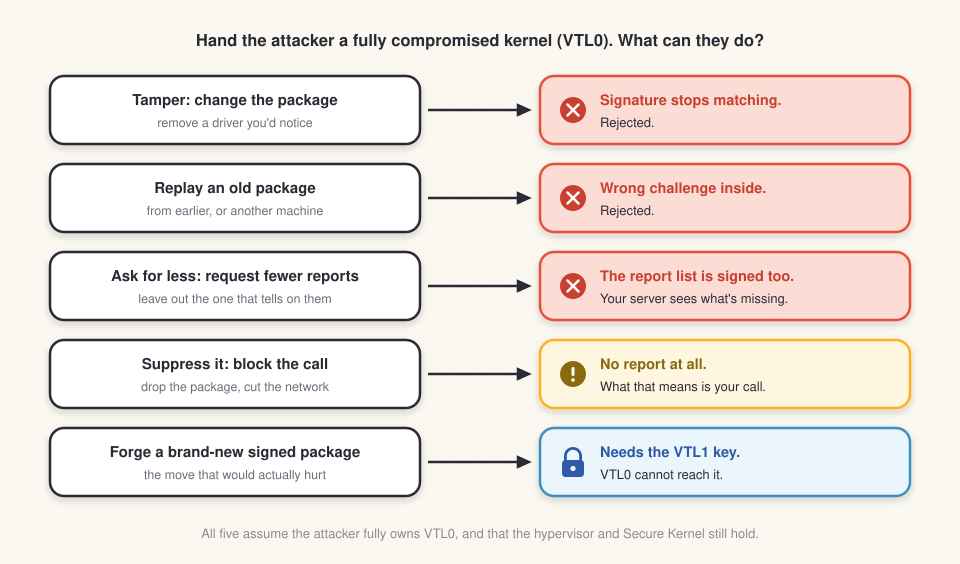

> Raw material moved out of Part 1 on 2026-11-25 when the series became six posts. Not yet shaped into a post.
{: .prompt-warning }

## Trusting the key

T

## Now give the attacker the kernel

Assume the attacker controls the entire normal kernel, while the hypervisor and the Secure Kernel are intact. These are the moves available.

**Tamper.** The attacker modifies the package, for example by removing a driver entry. Every report is bound to the signature through its digest, so any change makes verification fail and your server discards the package.

**Replay.** The attacker sends an old package, either one your server accepted earlier or one taken from another machine. That package contains a different challenge from the one in the current request, so your server rejects it.

**Ask for less.** The policy requires the driver report, so the compromised app requests only the hotpatch report and returns a package that is valid but incomplete. This is where the signed list of report types matters. The package states which report types it contains, the attacker cannot edit that list, and your server rejects any package that is missing a report its policy requires.

**Suppress.** The attacker blocks the call, drops the response, or runs with VBS disabled so that no report can be produced. An attacker can always stop a report from arriving. Whether a missing report counts as a failure is up to your server's policy.

None of these moves produces a valid VTL1 signature, because the signing key is out of the attacker's reach.

{: .shadow }
_Verification catches tampering and replay, and tells your server when a required report is missing. A missing package is a separate policy case._

There are three limitations to be aware of.

A report is a snapshot. It describes the machine up to the moment the Secure Kernel built it and says nothing about what happens afterwards, so a driver loaded a second later is not in it. The driver report helps here, because it also keeps entries for drivers that have since been unloaded, so the next report still shows that driver. This is why a service should request reports repeatedly, at times the machine cannot predict.

A report is also narrow. The driver report covers drivers and the hotpatch report covers hotpatched images. Neither says anything about malware running in user mode, for example. Consequently, a clean report is not the same thing as a clean machine.

The third limitation is a relay. A compromised machine can forward the challenge to a second, healthy machine, let that machine produce a genuine signed package, and return it to your server as its own. The nonce does not catch this, because both the signature and the challenge are genuine; they simply came from the wrong computer. This is the [cuckoo attack](https://www.usenix.org/event/hotsec08/tech/full_papers/parno/parno_html/){: target="_blank" rel="noopener" }, described by Bryan Parno in 2008, and it is not specific to Windows: every remote attestation scheme has to deal with it. Tracing the key back through the TPM tells your server which machine produced a report, but not that it is the machine your server meant to check. It's a known gap, and the report doesn't solve it today.